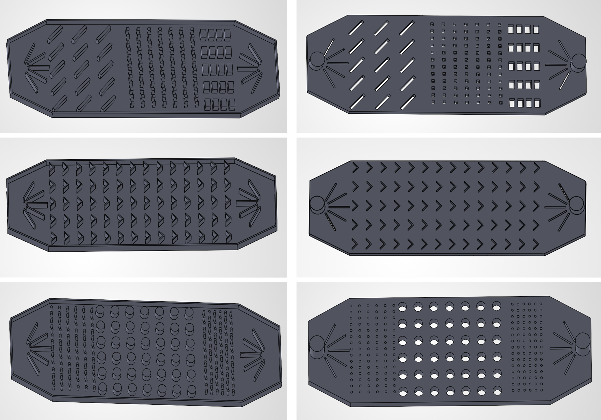
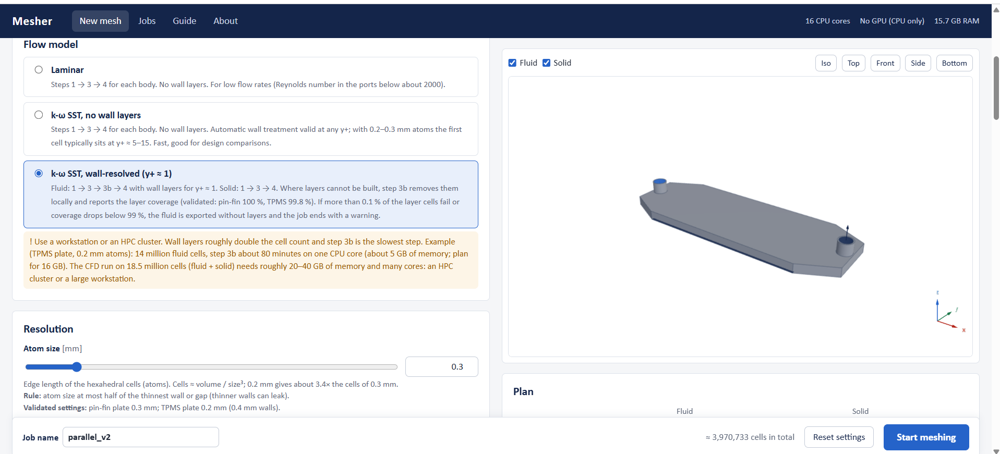
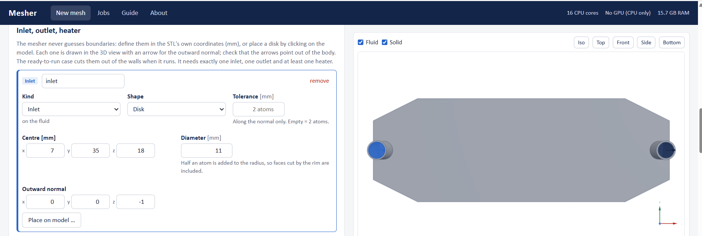
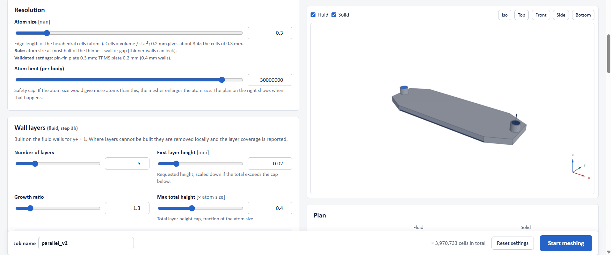
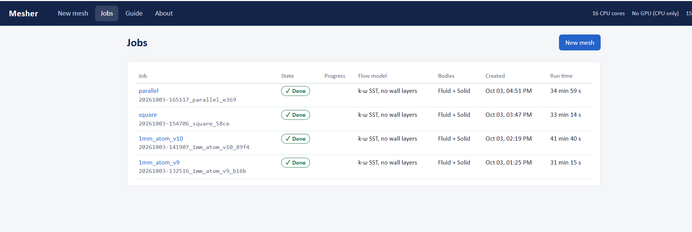
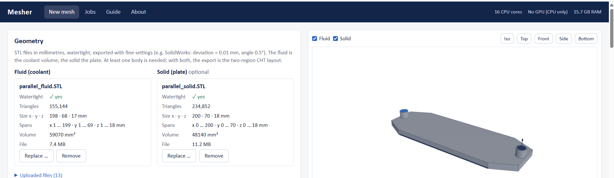
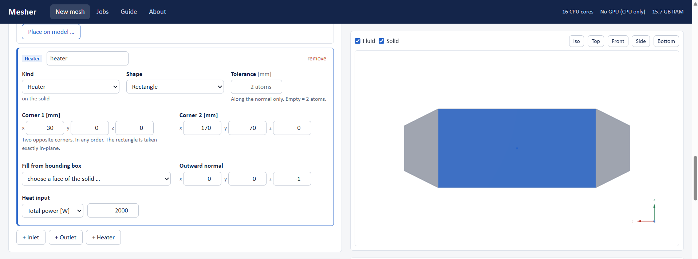
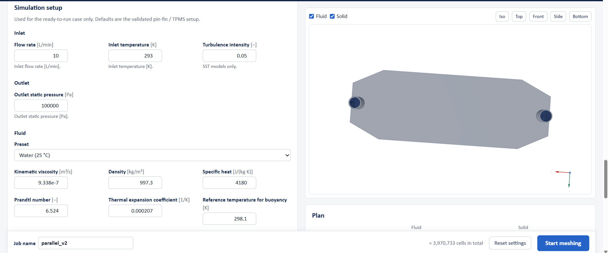
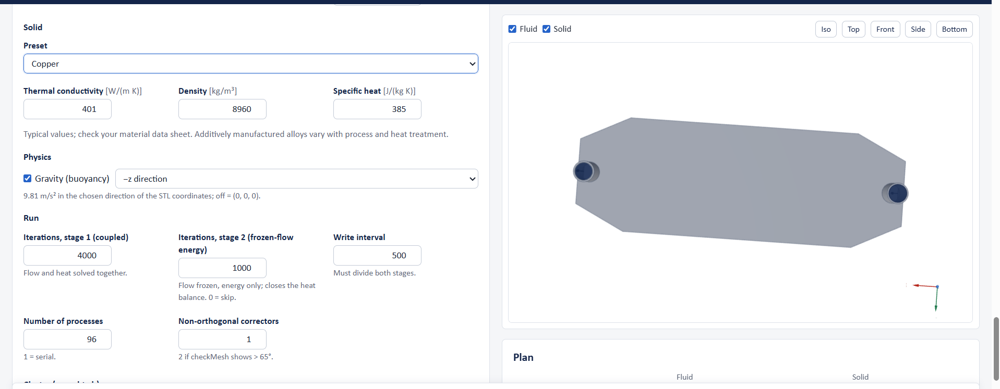
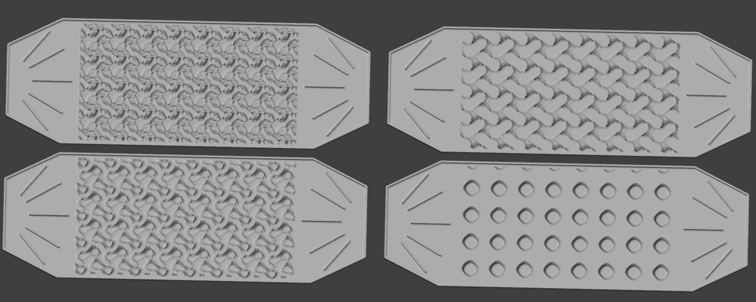

# AtomMesh: automatic all-hex meshing for conjugate heat transfer

AtomMesh turns a fluid STL and a solid STL into a two-region, all-hexahedral OpenFOAM mesh with wall-resolved boundary layers, and writes a ready-to-run `chtMultiRegionSimpleFoam` case. A graph neural network snaps the boundary nodes onto the CAD surface. The solid is meshed on the fluid's grid, so both regions share identical interface faces.

> **Status:** the code is not public. A live demo is available on request.
> Contact: <pvraditya.srt@gmail.com> · [LinkedIn](https://www.linkedin.com/in/pvraditya/)

## Key results

Seven cold plates (four pin-fin arrays, three TPMS lattices), meshed from STL with no manual repair:

- **Valid meshes:** all 14 regions pass OpenFOAM `checkMesh` ("Mesh OK"), with no inverted cells.
- **Wall-resolved:** mean first-cell y+ is 0.40–0.60, and wall-layer coverage is 99.8–100 %.
- **Energy-conserving interface:** 99.99–100.12 % of the heater power reaches the coolant. The interface heat error is 0.000 % on the pin-fins and at most 0.13 % on the TPMS lattices.
- **Fast:** 6–10 min per pin-fin plate and 33–111 min per TPMS plate on one GPU node. The full workflow, from STL to converged result, takes 1.1–4.9 h.
- **Against snappyHexMesh** (same plate, solver and case): the pressure drop agrees within 0.04 kPa. Meshing is 6× faster (6.2 vs 39 min), and wall layers cover 100 % of the interface instead of 93.5 %. AtomMesh leaves no faces failing `checkMesh`; snappyHexMesh leaves 5 per region.
- **Experimental benchmark** (Qu & Mudawar 2002 microchannel): the copper temperatures are within 1.9 K of the measurements on average. The paper's own simulation is within 3.8 K.

## Why

During my M.Sc. thesis on graph neural network surrogates for cold-plate cooling, I needed solver-ready meshes of TPMS lattices and pin-fin plates. Standard open-source meshing struggles with thin, strongly curved lattice walls and with conformal fluid–solid interfaces, so I built my own pipeline.

## How it works

1. **Atoms.** Each body is cut into cubic cells ("atoms") of one size. The solid uses the same lattice as the fluid.
2. **Snapping.** A graph neural network moves the boundary nodes onto the CAD surface. A Jacobian guard keeps every cell valid.
3. **Wall layers.** Five hexahedral layers at every fluid wall, for y+ below 1. Where a layer cell cannot be made valid, the layers are removed locally and the coverage is reported.
4. **Export.** OpenFOAM polyMesh for both regions. Every solid interface node takes the position of the matching fluid node.
5. **Case set-up.** Inlet, outlet and heater patches, materials, solver settings, and run scripts for a cluster (Slurm) and a workstation.

Flow models: laminar · k-ω SST without wall layers · k-ω SST wall-resolved (y+ ≈ 1).

The pipeline runs from a local desktop app with a Python backend and a 3D browser interface. You upload the STLs, place the patches on the model, check the cell-count plan, start meshing and download the case.

<table>
  <tr>
    <td></td>
    <td></td>
  </tr>
  <tr>
    <td></td>
    <td></td>
  </tr>
</table>

More screenshots

| | |
|---|---|
|  |  |
|  |  |

## Validation

**Set-up:** water at 10 L/min and 293 K, 2000 W heater, copper plate, k-ω SST, OpenFOAM v2312. Pin-fin plates use 0.3 mm atoms, and TPMS plates use 0.2 mm atoms.

### Mesh quality

| Criterion | Acceptance limit | Pin-fins (4) | TPMS (3) |
|---|---|---|---|
| checkMesh verdict | "Mesh OK" | 8 of 8 regions | 6 of 6 regions |
| Inverted cells | 0 | 0 | 0 |
| Min scaled Jacobian, fluid / solid | > 0 | 0.060 / 0.203 | 0.050 / 0.200 |
| Max non-orthogonality | ≤ 70° | 49.9–57.2° | 67.0–69.5° |
| Max skewness (OpenFOAM) | ≤ 4 | 3.44–3.56 | 3.56 |
| Mean first-cell y+ | < 1 | 0.40–0.60 | 0.57–0.59 |
| Wall-layer coverage | ≥ 99 % | 100 % | 99.8–100 % |
| Fluid / solid volume vs CAD | ≤ 1 % / ≤ 2 % | ≤ 0.20 % / ≤ 0.32 % | ≤ 0.12 % / ≤ 0.12 % |
| Interface area, fluid vs solid side | ≤ 1 % | 0.00 % | ≤ 0.06 % |
| Heater power reaching the coolant | within 1 % | 99.991–99.996 % | 100.03–100.12 % |
| Interface heat error | within 1 % | 0.000 % | 0.04–0.13 % |

Mesh sizes are 6.1–6.6 M cells for the pin-fin plates and 16.4–18.5 M cells for the TPMS plates, all hexahedral. Meshing the solid on the fluid's grid reduced the interface heat error from up to 7.4 % to 0.13 % or less.

### Mesh independence

| Plate | Atom sizes | Change in pressure drop | Change in peak heater temperature |
|---|---|---|---|
| Square pin-fin | 0.45 / 0.3 / 0.2 mm | 8.40 / 7.83 / 7.90 kPa | spread 0.6 K over the three grids |
| Gyroid TPMS | 0.2 → 0.15 mm | −4.2 % | −0.21 K |

The 0.3 mm pin-fin mesh is mesh-independent within the flow's own oscillation band.

### Comparison with snappyHexMesh

The parallel pin-fin plate was meshed with both tools from the same STLs and run with the same solver and case.

| Quantity | AtomMesh | snappyHexMesh |
|---|---|---|
| Total cells | 6.61 M (all hex) | 6.47 M (hex + polyhedra) |
| Faces failing checkMesh, per region | 0 | 5 (skewness > 4) |
| Max skewness, fluid / solid | 3.53 / 1.22 | 4.06 / 4.57 |
| Interface faces with wall layers | 100 % | 93.5 % |
| Mean y+ on the interface | 0.40 | 1.15 |
| Pressure drop | 4.89 kPa | 4.93 kPa |
| Heater average temperature | 306.93 K | 307.79 K |
| Meshing wall time | 6.2 min | 39 min |

### Experimental benchmark: Qu & Mudawar (2002)

This is a laminar microchannel heat sink (Re 890, 100 W/cm²), with temperature-dependent water viscosity and three grids of 1.1, 3.2 and 10 M cells.

| Quantity | Measured | Paper's simulation | AtomMesh, fine grid |
|---|---|---|---|
| Copper temperature, mean abs. difference to measurement | – | 3.8 K | 1.9 K |
| Total pressure drop | 30.5 kPa | 37.5 kPa | 40.8 kPa |

Both simulations over-predict the measured pressure drop. The channel pressure drop has a grid convergence index of 2.2 kPa on the fine grid.

### Reports and data

- [Mesh quality report (PDF)](Mesh_Quality_Report.pdf): all 17 criteria, values for each design, and the sources for each limit
- [validation_results.xlsx](validation_results.xlsx): every number above, plus the simulation set-up, meshing time, cost and the benchmark runs

## Scope and limitations

- Steady, single-phase CHT of internal flows (cold plates, heat exchangers). Fluid-only bodies are also supported.
- One cell size per mesh, so meshes are large. Adaptive local refinement is in development.
- Walls and gaps must be at least two atoms thick.
- STLs must be watertight and free of sealed internal voids. A design check in the app recommends an atom size and bridges small gaps.
- Open checks:
  - The growth ratio from the last layer to the core cell is above the 1.2 guideline. A 6-layer test changed the peak temperature by less than its oscillation band.
  - Two TPMS meshes are within 1° of the 70° non-orthogonality limit.
  - Solid skewness rises at atoms below 0.2 mm.
  - The wetted area has not yet been compared with the CAD.
  - There is no turbulent benchmark against measurements yet.

## Author

**Venkata Rama Aditya Philkhana**, simulation engineer (CFD, conjugate heat transfer, graph neural networks).
Related work: [Physics-informed GNN surrogate for cold-plate CHT](https://github.com/adityaphilkhana/pignn-cold-plate-cht)
